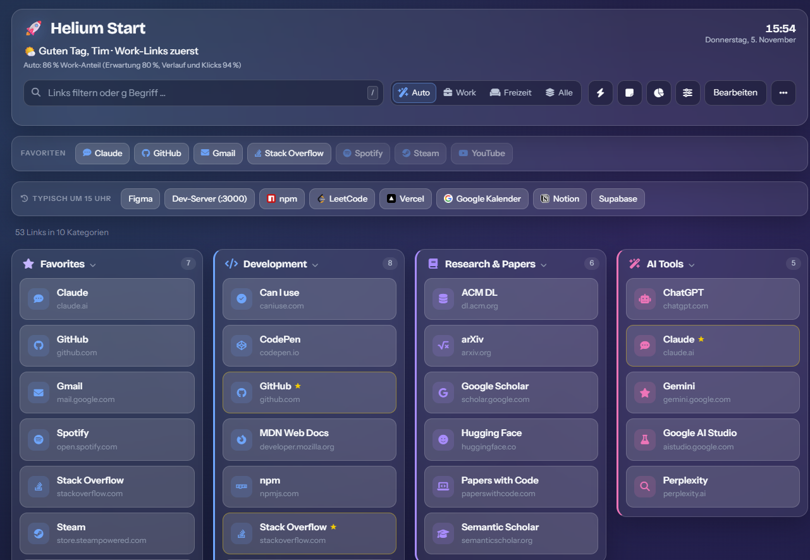

# Helium Start



A personal browser start page with a time-of-day mode, a command palette, notes,
and a small analytics dashboard for your own browsing history. Written in plain
HTML, CSS and JavaScript — **no build step, no backend, no framework, no tracking**.

### ▶ [Live demo](https://timlietzow03.github.io/helium-start/)

> The UI is in German and the demo data is fictional.

## What's in here

**`Nav.html` — the start page**
- Links grouped into silos, with a **time-of-day mode** that ranks Work links in
  the morning and free-time links in the evening (`Auto`, `Work`, `Freizeit`, `Alle`)
- **Command palette** (`Ctrl + K`) to jump to any link or run an action
- Full-text search with web shortcuts (`g something` → Google), `/` to focus
- Favorites, "most used this week", collapsible silos
- **Edit mode**: add, change, reorder and delete links — changes are stored in
  `localStorage`, never in the source file
- Notes panel, keyboard-first navigation

**`insights.html` — the analytics page**
- Import a browser history export (Chrome/Edge HTML) and see where your time went
- Calls per category, per hour, per weekday; services you used vs. links you never opened
- Suggestions for links worth adding, browser-profile planning, ready-made prompts for Claude
- Optional chat with your own Anthropic API key (stored only in `localStorage`,
  sent straight to the API — no proxy in between)

## Quick start

```bash
git clone https://github.com/timlietzow03/helium-start.git
cd helium-start
```

Open `Nav.html` in your browser. Done. A local server works too and avoids
`file://` quirks:

```bash
npx serve .
```

## How it works

No framework, no bundler — just a few well-separated scripts that share globals:

| File | Responsibility |
|---|---|
| `links-data.js` | Link silos (demo data in this repo) |
| `history-data.js` | History snapshot (demo data in this repo) |
| `local-data.js` | **optional, git-ignored**: your own links and real history |
| `storage.js` | Overlay store — additions, edits and deletions on top of the static silos |
| `app.js` | Rendering, filtering, favorites, drag-free editing |
| `time-mode.js` | Time-of-day ranking (hour weights, learned click times) |
| `helium-learn.js` | Learns at which hours you actually click which groups |
| `command-palette.js` | Fuzzy search over links and commands |
| `insights-core.js` | History parsing, host → service mapping, aggregation |
| `insights-ui.js` | Charts and cards for the analytics page |
| `insights-chat.js` | Minimal streaming chat UI for the Anthropic API |
| `ui-kit.js`, `nav-ui.js`, `usage-strip.js` | Shared UI primitives |
| `styles.css`, `polish.css`, `time-mode.css`, `nav-ui.css`, `insights.css` | Styles |

Two design decisions worth stealing:

1. **Static defaults + `localStorage` overlay.** The source files stay clean and
   diff-able; everything you change in the UI is a small overlay
   (`added` / `edited` / `deleted`) that is merged on load. Resetting means
   clearing one key.
2. **Data files are pluggable.** `links-data.js` and `history-data.js` just set a
   global. A second, git-ignored `local-data.js` can override both, so the public
   repo never contains personal data while the local page stays fully personal.

## Making it yours

Create `local-data.js` next to `Nav.html` (already in `.gitignore`):

```js
// Add your own silos
window.LINK_SILOS = window.LINK_SILOS || [];
window.LINK_SILOS.push({
    title: "My Links",
    icon:  "fa-solid fa-star",
    color: "#f59e0b",
    links: [{ title: "Example", url: "https://example.com/", icon: "fa-solid fa-link" }]
});

// Or your own history snapshot (format: DATE HOUR HOST COUNT)
window.HISTORY_SNAPSHOT = {
    generated: "2026-01-01",
    rows: `2026-01-01 09 github.com 3`,
    gh: [], accounts: [], observations: []
};
```

If the file is missing, the pages simply fall back to the demo data (you will
see one harmless 404 in the console — that's the optional file).

Set it as your browser's start page, or use it as a new-tab replacement via an
extension that accepts a local URL.

## Privacy

- Everything runs locally. There is no server, no analytics, no telemetry.
- The only network requests are the two CDNs for fonts/icons, and — if you
  explicitly use the chat on `insights.html` — the Anthropic API.
- Personal data lives exclusively in `local-data.js`, which is git-ignored, or in
  your browser's `localStorage`.

## Deutsch

Eine persönliche Browser-Startseite mit Tageszeit-Modus, Befehlspalette und
Verlaufs-Auswertung. Reines HTML/CSS/JS, kein Build, kein Server. Lokal genügt es,
`Nav.html` zu öffnen; eigene Links und der echte Verlauf gehören in die
git-ignorierte `local-data.js`. Die Demo-Daten im Repo sind frei erfunden.

## License

[MIT](LICENSE) — use it, fork it, strip it for parts.
